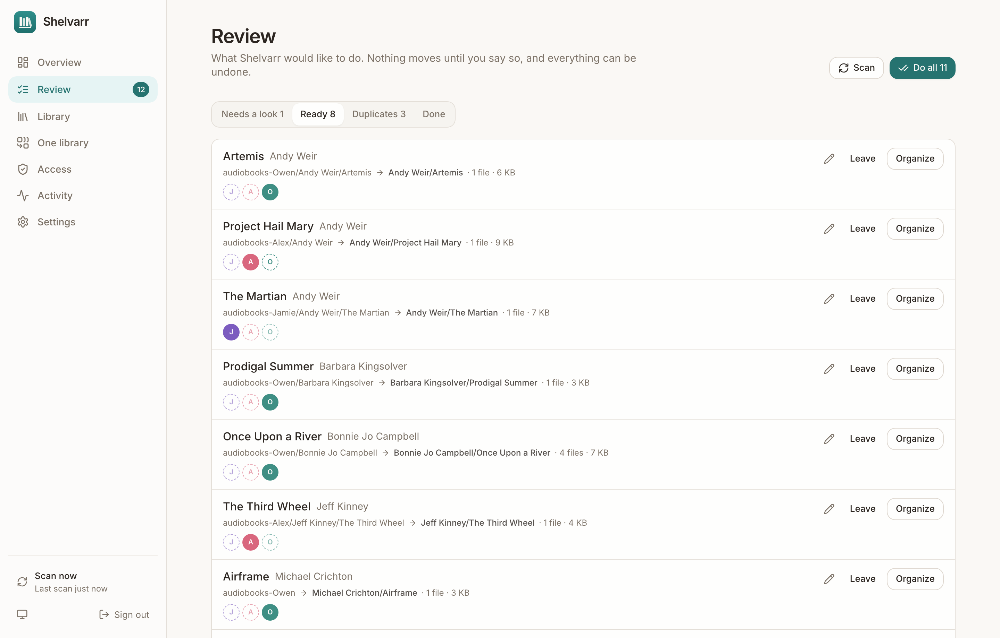
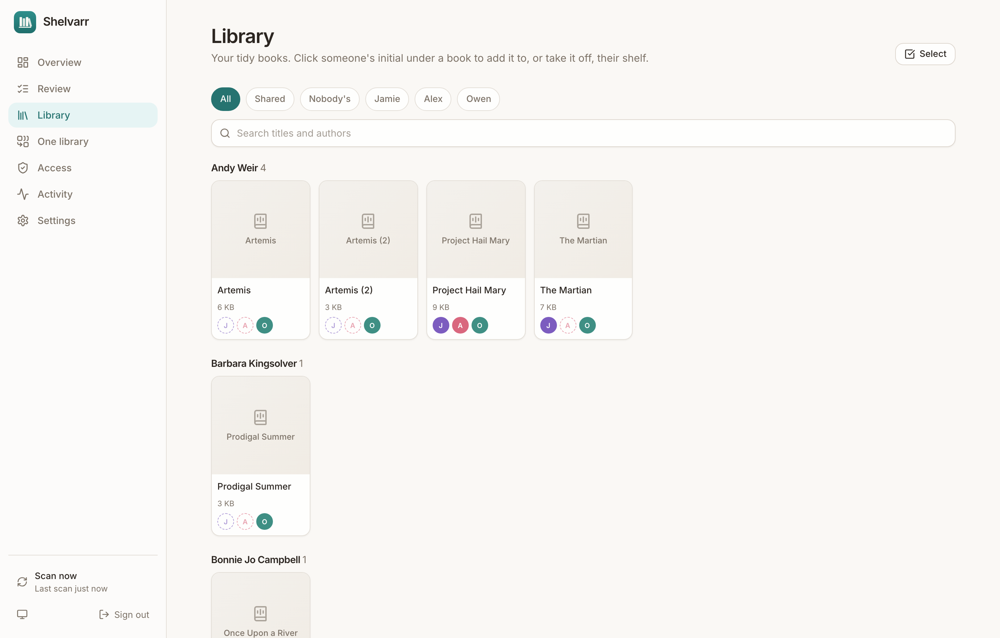
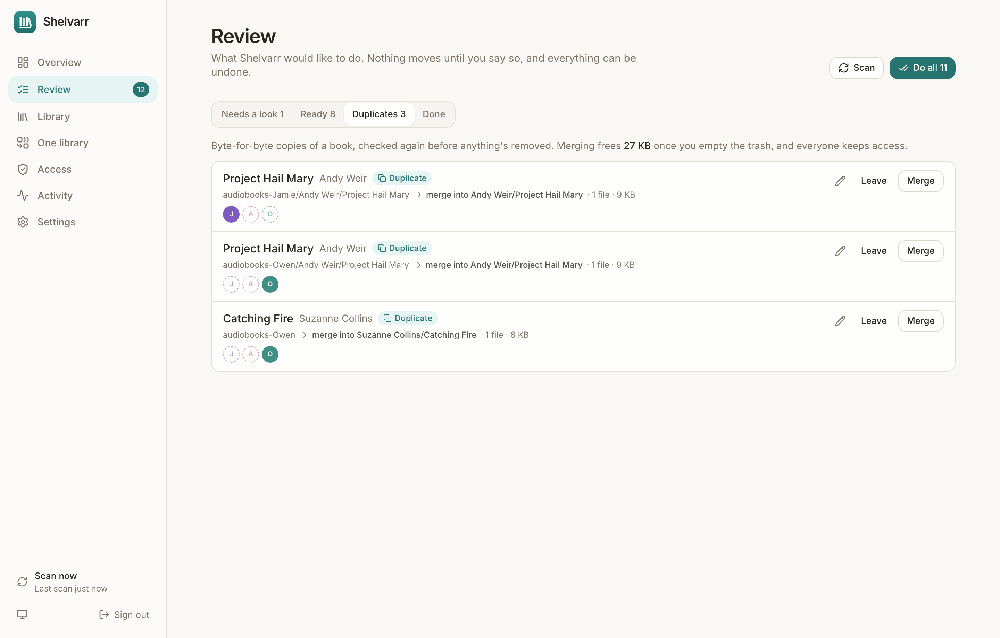
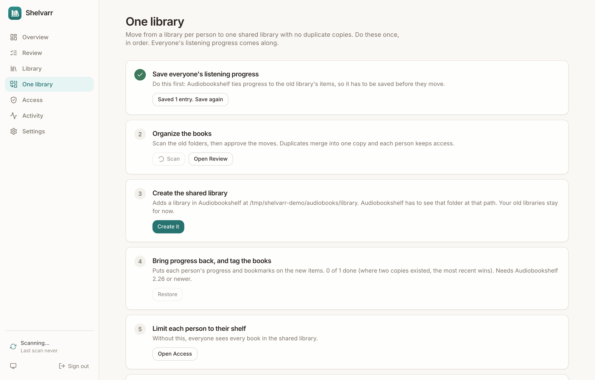
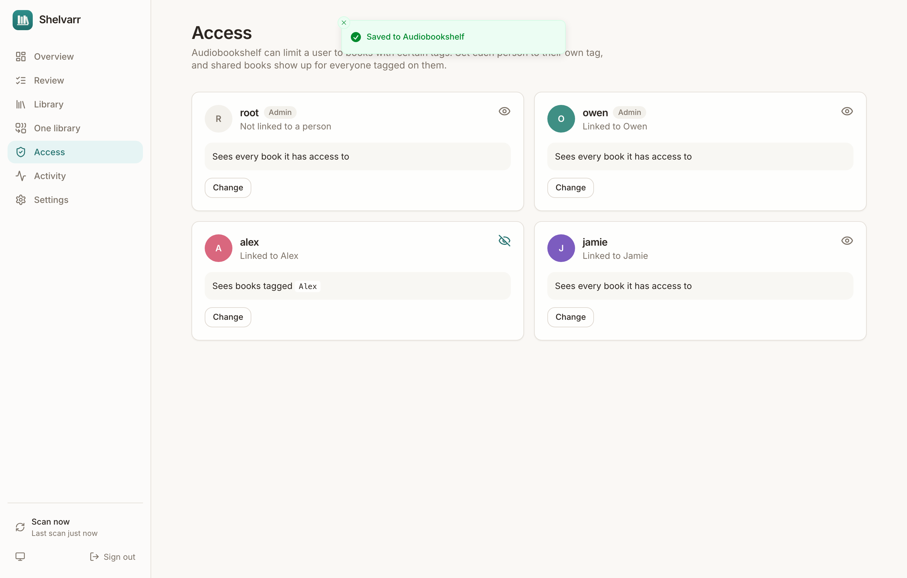

<div align="center">


# Shelvarr

**A tidy Audiobookshelf library, shared by a few people, with no duplicate copies.**<br/>
It sorts messy audiobooks into `Author/Book` folders, files new downloads as they arrive, and gives everyone their own shelf from one copy of each book.

[](https://github.com/OwenWright8/shelvarr/releases/latest)
[](https://github.com/OwenWright8/shelvarr/actions/workflows/ci.yml)

[](LICENSE)

[Quickstart](#quickstart) · [Shelfmark](#in-shelfmark) · [Audiobookshelf](#in-audiobookshelf) · [How it decides](#how-it-decides-what-a-book-is) · [Safety](#what-keeps-your-files-safe) · [FAQ](#faq)



</div>

> **Early days.** Shelvarr is new. Its tests run against real files and a fake Audiobookshelf built from Audiobookshelf's source, and it's been tried read-only on a real 36 GB library. Back up what you can't replace before your first run, and please [report what breaks](https://github.com/OwenWright8/shelvarr/issues).

## Why Shelvarr

Audiobooks arrive as a mess: `Andy Weir - Project Hail Mary  - Project Hail Mary.m4b` loose in one folder, ten `pt01.mp3` files in an author's folder, a book named after its author. And if you share a server, the usual way to keep shelves separate is one library per person, which means a full copy of any book two people want.

- **`Author/Book`, every time.** All of an author's books under one folder, and chapter files kept together in the book's own folder.
- **Cleans up what you already have.** It proposes every move first, and nothing happens until you approve it.
- **Files new downloads.** It watches the folder Shelfmark downloads to. Books it's sure of are filed on their own; the rest wait for you.
- **One copy, everyone's shelf.** Exact duplicates merge into one, and Audiobookshelf's per-user tags decide who sees what. Click a face to add someone to a book.
- **Listening progress comes along.** Moving from a library per person to one shared library keeps everyone's progress and bookmarks.
- **Hard to hurt yourself.** Every change can be undone, nothing's overwritten, and duplicates go to a trash folder until you empty it.
- **Seeding keeps working.** Downloads are hardlinked into the library, so the original stays put and no space is used twice.

<table>
  <tr>
    <td width="50%"></td>
    <td width="50%"></td>
  </tr>
  <tr>
    <td align="center"><sub>One copy of each book, on everyone's shelf who wants it</sub></td>
    <td align="center"><sub>Byte-identical copies merge into one</sub></td>
  </tr>
  <tr>
    <td width="50%"></td>
    <td width="50%"></td>
  </tr>
  <tr>
    <td align="center"><sub>Step by step from a library per person to one</sub></td>
    <td align="center"><sub>Who sees what, set from here</sub></td>
  </tr>
</table>

## Quickstart

**1.** Save this as `docker-compose.yml`, changing the paths and the user:

```yaml
services:
  shelvarr:
    image: ghcr.io/owenwright8/shelvarr:latest
    container_name: shelvarr
    restart: unless-stopped
    # The user that owns your audiobook files (run `id`).
    user: "1000:1000"
    environment:
      TZ: America/Indiana/Indianapolis
      AUDIOBOOKS_DIR: /media/audiobooks
      INCOMING_DIR: /media/downloads/audiobooks
    volumes:
      - ./data:/data
      # One mount holding both folders, so downloads can be hardlinked.
      - /path/to/Media:/media
    ports:
      - "8687:8687"
```

Create the `data` folder first, owned by that same user (`mkdir data`). Already running Audiobookshelf with Compose? Add Shelvarr to the same network, and it can reach it by name.

**2.** Start it, then open `http://<your-server>:8687`:

```sh
docker compose up -d
```

**3.** Create your account and follow setup. It connects to Audiobookshelf, checks it can write to your folders, finds your per-person folders, and asks about downloads. **Nothing moves during setup.**

**4.** The **One library** page then walks through the move, one step at a time.

## In Audiobookshelf

**Before you start**

1. You need version 2.26 or newer to carry over listening progress.
2. Make an API key: **Settings → API Keys → Add API Key**, and assign it to an admin user. Paste it into Shelvarr's setup. (On older versions, copy an admin's token under **Settings → Users**.)
3. Audiobookshelf must be able to see the folder Shelvarr organizes, and Shelvarr needs to know its path there. If Audiobookshelf mounts your audiobooks at `/audiobooks`, enter that under **The same folder, as Audiobookshelf sees it**.

**The move** (on Shelvarr's **One library** page)

1. **Save everyone's listening progress.** Do this before moving anything.
2. **Organize the books.** Scan, look through **Review**, and approve. Everything goes to a new `library` folder next to your old ones: `audiobooks/library/Author/Book`.
3. **Create the shared library.** Shelvarr adds it in Audiobookshelf, pointing at that folder, and gives linked users access.
4. **Bring progress back.** Everyone's progress and bookmarks go on the new items, and tags go on the books.
5. **Limit each person to their shelf.** On **Access**, click **Change** on each person's user. Until you do, they can see every book in the shared library, and the Overview reminds you. Admins can stay unrestricted.
6. **Check, then clean up.** Open Audiobookshelf as each person. When it's right, delete the old per-person libraries in **Settings → Libraries**, then empty the trash under Shelvarr's **Activity** to get the space back.

Folders that aren't linked to a person, like a `podcasts` folder next to your books, are never touched.

## In Shelfmark

Shelfmark needs almost nothing:

1. Find its **Audiobook destination** (your user's settings, or the default in its download settings). That folder is Shelvarr's **Downloads folder**, and both containers must be able to see it. Set it in **Settings → New downloads**.
2. Make sure that folder **isn't inside** Audiobookshelf's shared library. Files go from there into the library; Audiobookshelf shouldn't see them half-finished.
3. Leave Shelfmark's file naming however you like. Shelvarr sorts it out.
4. If you use Shelfmark's Library Check, point it at the new shared library once it exists.

**Whose book is it?** Shelvarr can't tell who a download was for, so new books go to the people under **New books belong to**. To share one, click the person's initial in the **Library**. If you have downloads in the folder already, click **Only handle new downloads** during setup, so old ones aren't suggested.

## How it decides what a book is

For each book, it weighs the evidence in this order, and tells you which it used:

1. **Tags in the audio file**, with the noise removed: `Hunger Games #2: Catching Fire` becomes `Catching Fire`, and narrators credited as authors are dropped.
2. **`metadata.json` or `.opf` next to the book**, if it's the only book in that folder. (A stale one in an author's folder isn't trusted.)
3. **File and folder names**: `Author - Title`, `Title by Author`, `It (2016) (Stephen King) {ASIN…}`.
4. **A tidy folder you already made** wins over a typo in the tags.

If the names around a file don't agree with its tags, it's marked **Not sure** and waits for you. For those, Shelvarr also **looks the book up online** through Audiobookshelf's own search (Audible, then Google, with no keys to set up) and offers the result as a one-click suggestion. The **Look up online** button works on any book. A lookup never moves anything by itself, because it can be wrong too.

## What keeps your files safe

- **Nothing moves without approval**, except new downloads it's sure of (you can turn that off).
- **Nothing is overwritten.** If something's already there, that book stops and goes back to where it was.
- **Duplicates are checked byte for byte** right before merging. If they differ, nothing's removed.
- **Trash, not delete.** Removed copies go to a hidden `.shelvarr-trash` folder, which Audiobookshelf ignores. Emptying it is the only permanent delete, and it only happens when you click it.
- **Undo.** Every change is reversible from **Activity**, until the trash it used is emptied.
- **Files changed since the scan?** Then the plan's out of date, and it asks you to scan again.
- **Audio is never edited.** Shelvarr moves files; it doesn't rewrite tags.

## Settings

Everything's in the app. In the container:

| Variable | What it does |
|---|---|
| `AUDIOBOOKS_DIR` | Starting value for the audiobooks folder. Change it later in Settings. |
| `INCOMING_DIR` | Starting value for the downloads folder. |
| `TZ` | Time zone for log timestamps. |
| `UPDATE_CHECK` | `off` stops the check for new releases (default `on`). |

Hardlinks only work inside one mount, which is why the quickstart mounts one folder holding both. With separate mounts, Shelvarr falls back to a verified copy, which uses the space twice.

## Homepage widget

Create a key under **Settings → Homepage widget**, then add this to your [Homepage](https://gethomepage.dev) `services.yaml`:

```yaml
- Shelvarr:
    icon: http://shelvarr:8687/icon-192.png
    href: http://shelvarr:8687/
    description: Audiobook shelves
    widget:
      type: customapi
      url: http://shelvarr:8687/api/widget
      refreshInterval: 300000
      headers:
        X-Api-Key: shv_your_key_here
      mappings:
        - { field: books, label: Books, format: number }
        - { field: to_review, label: To review, format: number }
        - { field: shared, label: Shared, format: number }
        - { field: unowned, label: Nobody's, format: number }
```

## Updating

Shelvarr tells you when a release is out, with its notes. To update:

```sh
docker compose pull && docker compose up -d
```

The database upgrades itself. Back up the `data` folder if you want to keep your history; it doesn't hold any audio.

## FAQ

**Do I have to use one shared library?**<br/>
No. Use it just to organize, with your own library pointing at the `library` folder. The sharing only needs tags.

**What about series folders (`Author/Series/Book`)?**<br/>
Not yet: Shelvarr uses `Author/Book`. Audiobookshelf still shows series from its metadata.

**Two different files of the same book?**<br/>
It asks: keep one, or keep both (the second becomes `Title (2)`).

**Does it unpack `.zip` or `.rar` downloads?**<br/>
No. Your downloader or Shelfmark needs to do that first; archives are ignored.

**Can the app see my files over the internet?**<br/>
Only if you publish its port. Keep it on your LAN or VPN, or behind a reverse proxy with HTTPS. See [SECURITY.md](SECURITY.md).

## Development

Needs Node 24.

```sh
npm ci
npm run dev:mock   # fake Audiobookshelf, and a messy demo library in ./demo
npm run dev        # API on :8687, UI on http://localhost:5173
npm test           # the real engine and real files against the fake
```

See [CONTRIBUTING.md](CONTRIBUTING.md).

## License

[MIT](LICENSE) © 2026 Owen Wright
